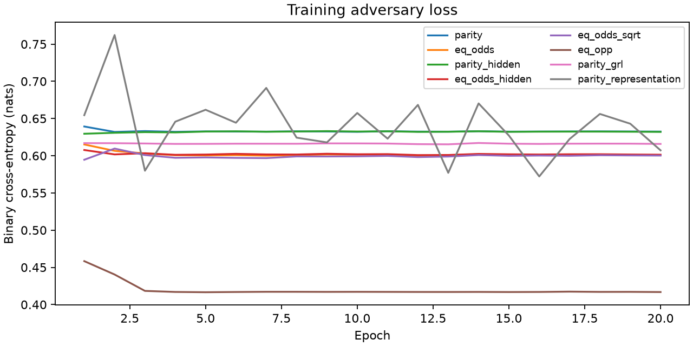
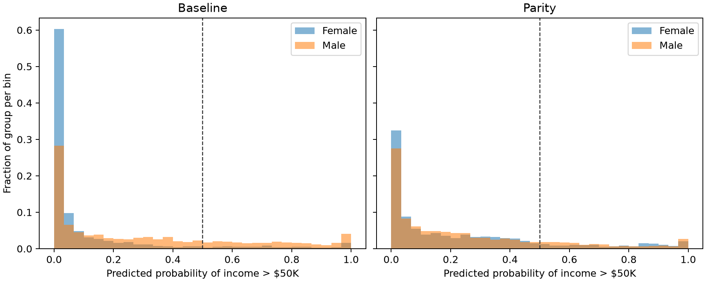

# Adversarial debiasing on UCI Adult

**Yuelin Li and Xiaoyu Chen**

UCI Adult, also called Census Income, is a dataset drawn from 1994 U.S. census records. The workshop uses information such as age, education, and occupation to predict whether a person's annual income exceeds $50,000. [UCI Adult data](https://archive.ics.uci.edu/dataset/2/adult)

Demographic parity reduced the sex-based test selection-rate gap from **18.24 to 2.26 percentage points (pp)**, but increased the true-positive-rate gap from **9.18 to 26.83 pp** and reversed its direction. Equalized odds reduced both conditional error-rate gaps and retained 84.68% accuracy, close to the 84.79% baseline.

## Data and experimental protocol

The task is to predict whether a record's income exceeds $50,000. The two UCI Adult source files were combined, and records with missing values were dropped, leaving 45,222 examples. We followed the starter's pooled, income-stratified 70/30 split and reserved 20% of its training portion for validation. This produced 25,324 training, 6,331 validation, and 13,567 test rows. Numeric scaling and one-hot vocabularies were fitted on training rows. The sex experiments set \(z=1\) for Male and remove sex from the inputs. The race experiments set \(z=1\) for White and remove race, keeping sex. Both use the same row splits and omit the census weight \(fnlwgt\). [UCI Adult dataset](https://archive.ics.uci.edu/dataset/2/adult)

The starter predictor is an MLP with two 64-unit ReLU layers. We used seed 42, 20 epochs, batches of 128, Adam, and cosine decay for the predictor learning rate. The predictor and adversary start at learning rates of \(10^{-3}\) and \(10^{-2}\), respectively. The linear adversary sees a softened predictor score for parity. For equalized odds it also gets the true label and score–label interactions. The projection is computed over the full predictor gradient vector, as in the paper's equation, where \(g_P\) and \(g_A\) are predictor-parameter gradients of task and adversary loss.

\[
g_{\mathrm{update}}
= g_P - \operatorname{proj}_{g_A}(g_P) - \alpha g_A.
\]

The projection removes the component of the task gradient parallel to \(g_A\). The last term encourages the predictor to increase adversary loss. The paper's Adult experiment used logistic regression and a different learning-rate schedule. Here we reproduced the approach using the supplied MLP and added validation-only epoch monitoring. The tables use final-epoch predictions, a common 0.5 threshold unless specified, and a single seed per configuration. [Zhang, Lemoine & Mitchell (2018), Sections 3 and 6](https://www.aies-conference.com/2018/contents/papers/main/AIES_2018_paper_162.pdf)

The DP gap compares positive prediction rates across groups. TPR is the positive prediction rate among actual positives, and FPR is the positive prediction rate among actual negatives. The tables report absolute gaps in percentage points. The CSVs also give each group's rates and signed differences.

## Sex experiment results

| Run | Accuracy | DP gap (pp) | TPR gap (pp) | FPR gap (pp) |
| --- | ---: | ---: | ---: | ---: |
| Baseline | 84.79% | 18.24 | 9.18 | 7.96 |
| Demographic parity | 83.25% | **2.26** | 26.83 | 3.14 |
| Equalized odds | 84.68% | 12.94 | 4.76 | 4.07 |
| Parity with hidden adversary | 83.25% | 3.01 | 25.54 | 2.42 |
| Equalized odds with hidden adversary | 84.75% | 13.61 | 4.24 | 4.80 |
| Equalized odds with square-root ramp | 84.62% | 13.08 | 6.18 | 4.52 |
| Equal opportunity | 84.81% | 16.15 | 3.53 | 6.57 |
| Parity with gradient reversal | 84.31% | 8.94 | 15.60 | **1.83** |
| Parity adversary on 64-unit representation | 84.83% | 14.21 | **1.81** | 5.03 |

[Full test metrics](results/sex/results.csv) · [Validation curves for the three core runs](results/sex/curves.png)

## Q1. How does adversary loss change?

| Mode | Epoch 1 | Epoch 2 | Epoch 5 | Epoch 20 | Best predictor-free reference |
| --- | ---: | ---: | ---: | ---: | ---: |
| Parity | 0.6393 | 0.6320 | 0.6327 | 0.6324 | 0.6326, \(H(Z)\) |
| Equalized odds | 0.6152 | 0.6066 | 0.6005 | 0.6009 | 0.6054, \(H(Z\mid Y)\) |

Both training losses fell early and then fluctuated within a narrow range. The parity adversary settled near the loss obtained by predicting the overall group prior. The equalized-odds adversary can use different group priors for \(Y=0\) and \(Y=1\), so its appropriate reference is lower. Its loss stayed about 0.0045 nats below that reference at epoch 20, consistent with some remaining group information in the score after conditioning on \(Y\). These are online losses from a jointly trained, finite-capacity adversary. The held-out gaps provide a separate check of the resulting decisions.

## Q2. How do the score distributions change?

The two held-out inference passes use the baseline and the parity model. The histograms share 30 bins, and each group's bar heights sum to one. The dashed line at 0.5 marks the decision threshold.

Under the baseline, female records concentrate near zero, and the male score distribution puts more mass above 0.5. Female and male mean scores were 0.117 and 0.307. With parity they moved to 0.235 and 0.248, and the distributions overlap much more. The fractions above 0.5 changed from 8.38% to 15.60% for female records and from 26.62% to 17.86% for male records. This is the source of the smaller DP gap at 0.5. The histograms pool both true labels, so they show marginal score distributions. [Distribution summary](results/sex/score_distribution.csv)

## Q3. Why does the TPR gap grow under parity?

The absolute TPR gap rose from 9.18 to 26.83 pp. In the baseline, TPR was 62.52% for male records and 53.33% for female records. In the parity model it was 46.70% for male records and 73.53% for female records. The FPRs also crossed, from 10.43% male and 2.47% female to 4.85% male and 7.99% female.

For group \(z\), let \(\pi_z=P(Y=1\mid Z=z)\). Its selection rate is \(q_z=\pi_z\,TPR_z+(1-\pi_z)\,FPR_z\). On test, \(\pi_M=31.08\%\) and \(\pi_F=11.62\%\). Using signed male-minus-female differences, the parity model's base-rate term \((\pi_M-\pi_F)(TPR_F-FPR_F)\) contributes \(+12.75\) pp. The TPR offset \(\pi_M(TPR_M-TPR_F)\) contributes \(-8.34\) pp, and the FPR offset \((1-\pi_M)(FPR_M-FPR_F)\) contributes \(-2.16\) pp. The three contributions sum to \(+2.26\) pp after rounding from unrounded values. Matching the overall selection rates in this run came with substantial changes in which actual positives the model detected.

## Q4. Can both criteria hold with different base rates?

For a binary decision, exact equalized odds gives common rates \(TPR=t\) and \(FPR=f\). The signed selection-rate difference then becomes

\[
q_M-q_F=(\pi_M-\pi_F)(t-f).
\]

With unequal base rates, exact demographic parity forces \(t=f\). The decision is then uninformative about the true label within each group. A constant decision or label-independent random rule can satisfy both. An informative underlying score may still be converted to an uninformative decision, so the conclusion concerns the binary decision and exact criteria. [Hardt, Price & Srebro (2016)](https://arxiv.org/abs/1610.02413)

## Q5. Why does removing sex leave a disparity?

The remaining features still contain group information. The largest absolute Pearson correlations with the Male indicator, computed on the training rows after one-hot encoding, were:

| Feature | Signed \(r\) |
| --- | ---: |
| Relationship = Husband | +0.585 |
| Marital status = Married-civ-spouse | +0.442 |
| Relationship = Unmarried | −0.322 |
| Relationship = Wife | −0.315 |
| Occupation = Adm-clerical | −0.282 |

Relationship categories directly encode gendered roles. Marital status and occupation can also act as proxies, and income prevalence differs across the groups. A predictor using these variables can produce different decisions across groups even after the explicit sex column is dropped. These correlations measure association with sex. They do not quantify how heavily the fitted model relied on any individual feature. [Full feature ranking](results/sex/sex_correlations.csv)

## Q6. Does a hidden adversary help?

The two runs add a 16-unit ReLU layer to the score-based adversary. For parity, the DP gap increased from 2.26 to 3.01 pp with almost identical accuracy. For equalized odds, the TPR gap improved from 4.76 to 4.24 pp while the FPR gap grew from 4.07 to 4.80 pp. The larger adversary therefore gave mixed results.

We measured stability as the population standard deviation of each validation gap across epochs 11–20. With the hidden layer, parity DP variability increased from 0.66 to 0.79 pp. In equalized odds, TPR variability increased from 0.48 to 0.67 pp and FPR variability from 0.17 to 0.24 pp. Greater capacity can detect nonlinear group signal, while also changing the gradients in the two-player optimization. These differences describe fluctuations within this seed.

## Q7. What does a square-root adversary schedule change?

We ran equalized odds with \(\alpha_t=\sqrt{t/T}\), where \(t\) is the optimizer step and \(T=3{,}960\). The weight starts near zero and ends at the constant run's weight of 1. The predictor's cosine decay stays fixed to isolate the effect of the ramp. The paper uses unnormalized \(\sqrt{t}\) with a predictor step size proportional to \(1/t\). [Zhang, Lemoine & Mitchell (2018), Section 6](https://www.aies-conference.com/2018/contents/papers/main/AIES_2018_paper_162.pdf)

The ramp reached 84.62% accuracy with DP, TPR, and FPR gaps of 13.08, 6.18, and 4.52 pp. All three gaps improved relative to the no-debiasing baseline. Constant-weight equalized odds had slightly higher accuracy and lower gaps on this split. The ramp spends most of training below the constant adversarial weight. That weaker pressure is one possible reason for the remaining gaps.

## Q8. What changes when the protected attribute is race?

| Run | Accuracy | DP gap (pp) | TPR gap (pp) | FPR gap (pp) |
| --- | ---: | ---: | ---: | ---: |
| Baseline | 84.75% | 10.58 | 8.29 | 4.02 |
| Demographic parity | 84.67% | **5.84** | 2.25 | **0.41** |
| Equalized odds | 84.72% | 8.44 | **1.51** | 2.61 |

On this split, the baseline White/non-White gaps were smaller than the baseline male/female gaps on all three metrics. The test base rates were 26.32% for White and 15.26% for the pooled non-White group, an 11.06 pp difference compared with 19.46 pp for sex. The two baselines also use different feature sets because each keeps the other attribute. Pooling all non-White categories gives a single contrast, with 288 true positives in the pooled group versus 3,074 White true positives. The pooled gap can hide variation across individual racial groups. [Race test metrics](results/race/results.csv) · [Race support and base rates](results/race/group_counts.csv)

## Q9. Equal opportunity versus equalized odds

The equal-opportunity adversary receives predictor scores only for training rows with \(Y=1\). The predictor still receives task loss on the entire batch. The test TPR gap fell to 3.53 pp from equalized odds' 4.76 pp, while the FPR gap rose to 6.57 pp from 4.07 pp. This is the expected trade-off for this run. The adversary targets score differences among true positives, while score differences among true negatives receive no direct adversarial penalty. [Hardt, Price & Srebro (2016)](https://arxiv.org/abs/1610.02413)

## Q10. Gradient reversal versus the baseline

The custom autograd layer passes predictor scores through unchanged on the forward pass and scales the incoming gradient by \(-\alpha\) on the backward pass. A single backward pass on \(L_P+L_A\) trains both networks. The adversary receives the ordinary loss gradient. The predictor receives \(g_P-\alpha g_A\), which keeps the task-gradient component along \(g_A\) that the projection update removes. [Ganin et al. (2016)](https://jmlr.csail.mit.edu/papers/v17/15-239.html)

Parity with gradient reversal reduced DP from 18.24 to 8.94 pp and FPR gap from 7.96 to 1.83 pp, while the TPR gap rose from 9.18 to 15.60 pp. It lost 0.48 pp of accuracy compared with baseline. The projection parity run closed the DP gap further, to 2.26 pp, at 1.06 pp lower accuracy than gradient reversal. The two updates therefore had different trade-offs even with the same adversary inputs and weight.

## Q11. What happens if the adversary sees 64 hidden features?

A linear parity adversary attached to the last 64-unit layer reduced test DP from 18.24 to 14.21 pp. The output-based parity model got to 2.26 pp, so the representation run removed much less of the original disparity. Its final test TPR gap was 1.81 pp, a separate outcome from its parity objective.

Over epochs 11–20, validation DP standard deviation rose from 0.66 pp for the output adversary to 0.90 pp for the representation adversary. Adversary-loss standard deviation rose from 0.00021 to 0.03260 nats. The loss trajectory was visibly more oscillatory. If the representation were truly independent of sex, any deterministic output derived from it would also be independent. In this run, a finite-capacity linear adversary and joint training leave room for group information to survive in the hidden features.

## Q12. Group-specific thresholds versus adversarial parity

The baseline model was evaluated with a common 0.5 threshold and then with two thresholds fitted on validation. We searched distinct score cutoffs, kept both groups' selection rates between zero and one, and maximized validation accuracy subject to a DP gap of at most 0.5 pp. This selected **0.194563 for female records** and **0.669640 for male records**. The same thresholds were applied to test without refitting. The separately trained parity model used 0.5 for both groups.

| Split | Decision rule | Accuracy | DP gap (pp) | TPR gap (pp) | FPR gap (pp) |
| --- | --- | ---: | ---: | ---: | ---: |
| Validation | Baseline, 0.5 | 85.36% | 19.10 | 12.47 | 8.30 |
| Validation | Baseline, group thresholds | 83.62% | **0.48** | 28.49 | 5.03 |
| Validation | Adversarial parity, 0.5 | 83.98% | 2.21 | 27.01 | 3.27 |
| Test | Baseline, 0.5 | 84.79% | 18.24 | 9.18 | 7.96 |
| Test | Baseline, group thresholds | 83.21% | **0.18** | 33.86 | 4.56 |
| Test | Adversarial parity, 0.5 | 83.25% | 2.26 | 26.83 | 3.14 |

Post-processing is simpler to fit because it reuses the baseline and adjusts two cutoffs. It performed better on held-out DP at nearly the same accuracy, while adversarial parity produced smaller TPR and FPR gaps of the two mitigation methods. The threshold rule needs sex at decision time. The adversarial parity model uses the same threshold for all records and changes the score distributions, which matters when the scores will be reused at other thresholds. If the sole objective is selection-rate parity and the group field is available when scoring, the fitted thresholds worked better here. If a common decision threshold or lower conditional gaps matter, adversarial training better fits those priorities in this comparison. [Full validation and test comparison](results/sex/threshold_comparison.csv)
